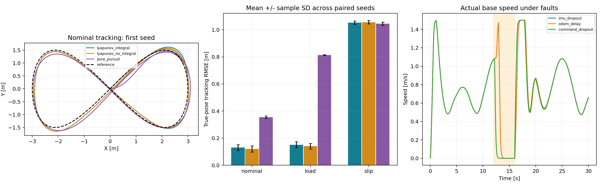

# ROS2 AMR Trajectory Tracking, Sensor Fusion & Telemetry

I use this project to study trajectory tracking and wheel/IMU sensor fusion for a differential-drive AMR. It combines a C++17 controller, a Python estimator, a numerical plant, and read-only WebSocket telemetry. The reference is a figure-eight trajectory; this is not a navigation stack.

The controller uses a **Lyapunov-style nonlinear tracking law with integral action**, command saturation, and a linear acceleration limit. There is no NMPC optimizer or online gain adaptation. The historical ROS package and Python module name remains `ros2_amr_nmpc_telemetry` for compatibility; the repository name describes the implemented capabilities.

## Implemented system

| Node | Inputs | Outputs / role |
|---|---|---|
| `ekf_localization_node` | `/wheel_odom` (Odometry), `/imu/data` (Imu) | `/odometry/filtered` (Odometry), `/localization/gyro_bias` (String JSON) |
| `adaptive_controller_cpp_node` (default) | `/odometry/filtered` | `/cmd_vel` (Twist), `/controller/telemetry_json` (String) |
| `telemetry_bridge_node` | `/controller/telemetry_json` | WebSocket snapshots at `ws://127.0.0.1:8765` |
| `adaptive_controller_node` (alternative) | `/odometry/filtered` | `/cmd_vel`, built-in WebSocket server |
| `simulator_node` | `/cmd_vel` | wheel odometry, IMU, `/ground_truth`, `/joint_states`, `/simulation/status` |
| `visualization_node` | ground truth, filtered odometry | `/simulation/true_path`, `/simulation/estimated_path`, `/simulation/reference_path`, display TF |
| `command_watchdog_node` (Gazebo only) | `/cmd_vel` | `/gazebo/cmd_vel`, zero on command receipt timeout |

Exactly one controller is launched. The C++ default requests 100 Hz; Python requests 50 Hz; the EKF requests 50 Hz and telemetry 20 Hz. Measured execution rates do not establish hard real-time guarantees.

The six-state estimator tracks `[x, y, yaw, v, omega, gyro_bias]`. Wheel yaw rate observes `omega`, and the gyro observes `omega + gyro_bias`. A conservative consider-style measurement update learns rates and bias while pose propagates kinematically. It does not use absolute pose, IMU orientation, or ground truth. Bias estimation depends on an unbiased, correctly scaled wheel yaw rate without slip. See [filter assumptions and equations](docs/GYRO_BIAS.md).

Filtered odometry uses `odom` and child `base_link`. Simulation paths use `odom`. The visualization node broadcasts ground-truth `odom → base_footprint` for display, and robot-state publishing supplies `base_footprint → base_link` and wheel/caster transforms. This display TF is not estimated localization. The closed-loop-only launch supplies no TF broadcaster or plant. There is no `map` frame or map localization.

Both controllers reject invalid/stale state, reset control memory on stops, and bound commands. Source timestamp ordering/freshness checks complement receipt timeouts. These checks cannot stop a robot if its controller or driver dies; a real driver needs its own timeout. The Gazebo ROS command gate also cannot protect against its own death or bridge failure.

## Environment and dependencies

Local preparation used ROS 2 Jazzy, Python 3.12.3, GCC 13.3.0, CMake 3.28.3, NumPy 1.26.4, Matplotlib 3.6.3, pytest 7.4.4, PyYAML 6.0.1, and WebSockets 14.2. The installed ROS versions are rclcpp 28.1.22, rclpy 7.1.12, rmw_fastrtps_cpp 8.4.4, robot_state_publisher 3.3.4, and rviz2 14.1.24. These describe the inspected environment, not minimum supported versions. Humble and other dependency combinations have not been verified in this preparation.

`package.xml` declares the core ROS/runtime/test dependencies. Matplotlib is needed for experiment reports. Optional Gazebo support requires `ros-jazzy-ros-gz` and the matching Gazebo Harmonic installation. Clean-system provisioning has not been verified. On a configured Jazzy machine, the intended dependency setup is:

```bash
source /opt/ros/jazzy/setup.bash
sudo apt install python3-colcon-common-extensions python3-rosdep python3-matplotlib
# If rosdep has not been initialized: sudo rosdep init
rosdep update
rosdep install --from-paths . --ignore-src -r -y --rosdistro jazzy
```

Run commands below from the repository root. Use an unused ROS domain without a physical robot attached; these tests publish motion commands.

## Build, launch, and test

```bash
source /opt/ros/jazzy/setup.bash
export ROS_DOMAIN_ID=193 ROS_LOG_DIR=/tmp/amr-ros-logs OPENBLAS_NUM_THREADS=1
export MPLCONFIGDIR=/tmp/amr-mpl
colcon build --base-paths . --symlink-install --cmake-args -DCMAKE_BUILD_TYPE=Release
source install/setup.bash
colcon test --packages-select ros2_amr_nmpc_telemetry --return-code-on-test-failure
colcon test-result --verbose

# Numerical plant + EKF + C++ controller + telemetry + paths
ros2 launch ros2_amr_nmpc_telemetry amr_simulation.launch.py controller:=cpp
# Stop the first launch before running the alternative:
ros2 launch ros2_amr_nmpc_telemetry amr_simulation.launch.py controller:=python
# Add rviz:=true on a graphical host; seed:=42 and scenario:=slip are examples.
```

The numerical simulator uses wall time and does not publish `/clock`. For external sensor publishers and a driver consuming `/cmd_vel`, use `amr_closed_loop.launch.py` instead. The reference starts at controller startup: `x=3 sin(0.25t)`, `y=3 sin(0.25t) cos(0.25t)`. This launch is not a hardware deployment procedure.

```bash
# After building and sourcing install/setup.bash; stop other launches first.
python3 scripts/simulation_smoke_test.py --controller cpp --scenario nominal --output /tmp/amr-nominal.json
python3 scripts/hybrid_smoke_test.py --controller cpp --output /tmp/amr-websocket.json
scripts/validate_runtime.sh /tmp/amr-runtime-new
```

The full runtime script covers both WebSocket backends and six sensor/command fault scenarios per controller. Unit tests cover control limits, filter covariance/bias behavior, freshness, assets, ROS node behavior, and 3,000 stateful C++/Python control comparisons. Passing the mathematical comparison alone does not validate ROS scheduling. [Preparation checks](docs/PREPARATION.md) separate current execution from historical evidence and unavailable checks.

Telemetry contains estimated pose, reference pose, commands, elapsed time, and estimated tracking error. This error is not ground-truth accuracy. The service binds to loopback by default and implements no authentication, TLS, or inbound motion control.

## Saved results and reproduction

The [latest 120-trial matrix](docs/experiments_bias_v3/REPORT.md) contains three controller configurations, eight scenarios, and five paired seeds, with 30 s per trial. Integral tracking has mean true-pose RMSE **0.1307 m nominal**, **0.1508 m under load**, and **1.0527 m under slip**. Without integral action the corresponding nominal/load values are 0.1195/0.1406 m: integral action is worse in those saved configurations. The fixed 0.6 s time-preview Pure Pursuit baseline is unoptimized; these results do not rank controller families.



The [gyro-bias report](docs/GYRO_BIAS_RESULTS.md) retains paired 240 s trials, regressions, and rejected prototype results. Nominal mean true error over the last 30 s improved from 2.3168 to 0.1838 m under the wheel-model assumptions, while transient-slip tail error worsened from 2.5417 to 2.7517 m. Low estimated error can coexist with several metres of true error. The simpler zero-bias benchmark also regressed from 0.0813 to 0.2174 m true tracking RMSE. Models, seeds, per-trial CSVs, summaries, and representative traces are retained; large full offline trace archives are omitted as described in [evidence notes](docs/EVIDENCE.md).

These are historical saved results unless explicitly marked rerun in the preparation record. They are numerical simulation results, not hardware validation or measured C++ versus Python scheduling comparisons.

```bash
# From repository root; new output directories preserve the saved evidence.
OPENBLAS_NUM_THREADS=1 python3 scripts/run_experiments.py --output-dir /tmp/amr-experiments-new
OPENBLAS_NUM_THREADS=1 python3 scripts/validate_gyro_bias.py --output /tmp/amr-bias-new
python3 scripts/standalone_benchmark_colab.py --seed 42 --output-dir /tmp/amr-benchmark-new
# Requires built/sourced ROS installation; runs the C++ numerical pipeline:
python3 scripts/long_localization_check.py --duration 240 --seed 42 --output /tmp/amr-long-new.json
```

## Gazebo and remaining work

The optional Gazebo launch is `ros2 launch ros2_amr_nmpc_telemetry amr_gazebo.launch.py gui:=false rviz:=false`. It uses simulated time, DiffDrive/IMU plugins, a ROS bridge, the C++ controller, and a command gate. A [saved host run](docs/release/host-gazebo-20261020T192814Z/gazebo.json) reports 0.8024 m tracking RMSE over 20.027 simulated seconds, with controller-stall stopping and recovery. This short run is limited evidence: Gazebo tracking remains substantially imperfect, and there is no full Gazebo fault matrix, long-duration validation, or hardware validation. The physical sensor axes, offsets, contacts, and failure behavior still require review.

LiDAR integration, SLAM Toolbox, and Nav2 are **planned, not implemented**. Other planned work includes external pose correction, wheel-slip handling, improved Gazebo tracking, hardware sensor calibration and testing, and broader runtime stress tests. Velocity-only sensing cannot recover absolute pose after slip or outages. No obstacle avoidance, hardware safety certification, or hard real-time guarantee is claimed.

The Dockerfile and GitHub Actions workflow describe intended Jazzy builds and checks. Their presence does not establish a successful image build, container run, clean-system install, or remote workflow execution. See the preparation record for what was actually executed. No GitHub repository or push was performed during local preparation.

## Robotics & Embodied AI Graduate Portfolio Series

This repository is Part 1 of the 5-project robotics and physical AI graduate portfolio by **[Youseef Abdel Tawwab](https://github.com/youseefahmed794)**:
1. **[ros2-amr-tracking-fusion-telemetry](https://github.com/youseefahmed794/ros2-amr-tracking-fusion-telemetry)**: Nonlinear tracking control, 6-state EKF sensor fusion, and live WebSocket telemetry digital twin.
2. **[ros2-amr-slam-navigation](https://github.com/youseefahmed794/ros2-amr-slam-navigation)**: 2D LiDAR graph SLAM, Nav2 autonomous navigation, AMCL probabilistic localization, and dynamic obstacle avoidance in Gazebo Harmonic.
3. **[ros2-manipulation-grasping](https://github.com/youseefahmed794/ros2-manipulation-grasping)**: 6-DOF robotic manipulator, C++17 DLS inverse kinematics, quintic polynomial trajectories, 3D point cloud perception, and antipodal grasp planning.
4. **[sim2real-robot-rl](https://github.com/youseefahmed794/sim2real-robot-rl)**: Sim-to-Real reinforcement learning (PPO) for dynamic quadruped locomotion across rough terrain with comprehensive domain randomization.

## License and credits

The existing MIT license and copyright notice are preserved in [LICENSE](LICENSE); see [third-party references and provenance](THIRD_PARTY_NOTICES.md). Maintained by [Youseef Abdel Tawwab](https://github.com/youseefahmed794).
