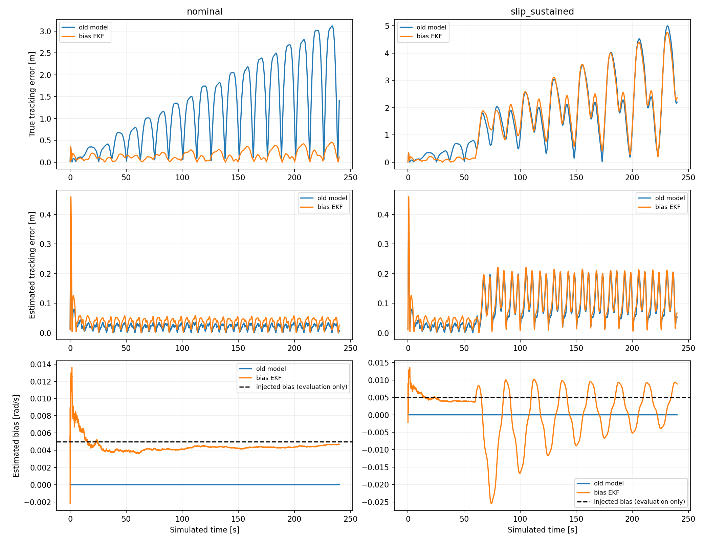

> Historical results recorded on 2026-10-20. See [current preparation checks](PREPARATION.md). Full offline trace archives and process logs are omitted from this publication copy; retained evidence and omissions are listed in [EVIDENCE.md](EVIDENCE.md).

# Gyro-bias correction: executed results — 2026-10-20

Nominal bias-driven drift is substantially reduced under unbiased non-slipping wheel-rate assumptions. Absolute pose recovery and safe tracking through arbitrary slip are not established; full release sign-off remains incomplete.

## Final implementation and validation

Six-state wheel-referenced bias estimation plus a conservative consider-pose measurement update. Raw gyro observes omega+bias; wheel yaw observes omega. The estimator starts bias at zero. No scenario name, fault window, injected bias or ground-truth pose is estimator input. Existing noise settings, controllers, gains, command limits and default injected +0.005 rad/s bias are unchanged.

**Executed:** C++17 Release build; 37 automated results, zero failures/errors/skips; 12 actual ROS scenario/backend tests; two separate 240-second installed C++/Python-EKF ROS runs; 110 paired 240-second offline trials; regenerated 120-trial three-controller matrix and the simpler seed-42 benchmark.

Automated coverage adds unknown signed bias, rate/bias non-observability with gyro alone, indistinguishable wheel yaw bias, no absolute heading recovery, PSD/symmetric covariance, consider-pose covariance behavior, invalid gyro rejection and old-five-state numerical reproduction. [Saved JUnit/CTest evidence](release/gyro-bias/final_test_results/). Build and process logs remain in the original project archive.

## Paired four-minute results

Five seeds `[11,23,42,71,101]`; identical noise sequences/draw counts, initial state, plant, controls and limits within each ablation pair. The feedback trajectories differ. Long runs use the integral tracker; they are estimator comparisons, not measured C++ versus Python timing comparisons. Means and sample SD below are for the final 30 seconds, including slip where it is active.

| Profile | Old-filter TRUE RMSE [m] | Final TRUE RMSE [m] | Final ESTIMATED RMSE [m] |
|---|---:|---:|---:|
| nominal | 2.3168 ± 0.0277 | 0.1838 ± 0.0962 | 0.0387 ± 0.0006 |
| load | 2.3165 ± 0.0277 | 0.1881 ± 0.0929 | 0.0387 ± 0.0006 |
| slip_transient | 2.5417 ± 0.0254 | 2.7517 ± 0.1272 | 0.0387 ± 0.0006 |
| slip_sustained | 3.0323 ± 0.0351 | 2.8607 ± 0.0894 | 0.1312 ± 0.0002 |
| imu_dropout | 4.0641 ± 0.0436 | 2.2901 ± 0.1110 | 0.0387 ± 0.0006 |
| odom_dropout | 3.9731 ± 0.0488 | 2.3296 ± 0.0964 | 0.0387 ± 0.0006 |
| odom_delay | 3.9731 ± 0.0488 | 2.3296 ± 0.0964 | 0.0387 ± 0.0006 |
| nonfinite | 3.9731 ± 0.0488 | 2.3296 ± 0.0964 | 0.0387 ± 0.0006 |
| command_dropout | 2.3192 ± 0.0295 | 0.2339 ± 0.0890 | 0.0387 ± 0.0006 |
| negative_bias | 3.7823 ± 0.0211 | 0.1878 ± 0.1004 | 0.0387 ± 0.0006 |
| positive_bias | 0.7122 ± 0.0183 | 0.1887 ± 0.0947 | 0.0387 ± 0.0006 |

Nominal mean true tail RMSE fell from 2.3168 m to 0.1838 m; all five paired seeds improved. Final true nominal tail errors range from 0.0993 to 0.3120 m, while estimated error averages 0.0387 m. Seed 42 fell from 2.3157197 to 0.1142446 m true tail RMSE, with unchanged injected bias. Whole-run nominal true RMSE also improves (1.5032 → 0.1724 m), while estimated RMSE increases (0.0308 → 0.0479 m). These are measured improvements in true-pose accuracy, not an absolute pose bound. For the large +0.03 rad/s bias, the old filter's whole-run true RMSE is 3.2577 m despite its lower 0.7122 m final-window RMSE: heading wrapping and lap phase can make a tail window alone misleading.

Transient slip is injected at 12–16 s. Sustained slip scales linear/angular ground motion to 65% while encoders continue measuring wheels over 60–240 s. Sensor/command faults repeat at 60–64 and 180–184 s, testing operation after bias learning as well as recovery. Additional -0.02/+0.03 rad/s cases establish that the estimate is not hard-coded to +0.005.

Finite/command-limit/covariance-bias and fault-stop/motion-recovery checks passed in all 110 trials. There are 100 checked fault windows. This count does not assert acceptable tracking in every profile. A low estimated tracking error after a fault can coexist with several metres of true error. Stop decision delay is measured separately from settled physical-model speed.

[Per-trial metrics](release/gyro-bias/long-runs/trials.csv), [full true/estimated/tail summaries](release/gyro-bias/long-runs/summary.json), [fault checks](release/gyro-bias/long-runs/checks.json), [seeds/source hashes/model manifest](release/gyro-bias/long-runs/manifest.json), full offline traces (omitted here; regenerate with `validate_gyro_bias.py`).



## Actual four-minute ROS pipeline measurements

These runs launched the installed numerical plant, EKF, C++ controller, state publisher and path visualization. ROS truth and filtered source stamps were interpolated onto absolute controller reference `stamp_sec`; raw arrays and 1 Hz bias/variance/freshness histories are retained. Runs used ROS domains 191/192 without physical robots, concurrently with other validation activity. They are additional runtime evidence, not bit-identical replicas of the synchronous offline matrix.

| Seed | Duration | Whole-run true/estimated RMSE [m] | Last 30 s true/estimated RMSE [m] | Final bias [rad/s] | Cmd receipt Hz |
|---:|---:|---:|---:|---:|---:|
| 11 | 240 s | 0.1889 / 0.0945 | 0.2420 / 0.0369 | 0.004731 | 100.00 |
| 42 | 240 s | 0.1615 / 0.0959 | 0.2221 / 0.0368 | 0.004560 | 100.00 |

[Seed 11 JSON](release/gyro-bias/final_ros_seed11.json), [trace](release/gyro-bias/final_ros_seed11.npz), [seed 42 JSON](release/gyro-bias/final_ros_seed42.json), [trace](release/gyro-bias/final_ros_seed42.npz). Corresponding `.bias.json` files retain sensor evidence; process logs remain in the original archive. The reported frequency is continuous command receipt frequency, not worst-case callback latency or a real-time guarantee.

All six numerical process scenarios also passed for each controller with the final estimator: [twelve results](release/gyro-bias/final_ros_scenarios/). These check zero commands/settled speed and motion recovery, TF, all three paths, joint motion and publisher count. The multi-minute live runs use the C++ controller; multi-minute Python-controller/Gazebo/hardware tracking has not been executed.

## Regressions and rejected prototype retained

The first full joint six-state EKF produced nominal true tail RMSE 0.2232 m, but sustained-slip tail RMSE 13.9426 m versus the old filter's 3.0323 m. It also caused large estimated-pose excursions through pose/bias correlations under an invalid slip model. All 110 prototype trial metrics, two four-minute ROS traces, tests and sources remain in [prototype-joint/](release/gyro-bias/prototype-joint/); its 30-second matrix remains at [experiments_bias_v2](experiments_bias_v2/REPORT.md). It was rejected rather than deleting the unfavorable runs.

The final consider policy withholds rate-only pose corrections for every scenario, maintaining covariance with the modified-gain Joseph update. It is deliberately conservative and not a claim of optimality or perfect nonlinear consistency. It substantially reduces the prototype divergence, but sustained slip still has roughly 2.86 m tail true error and approximately 0.131 m estimated error. Differential slip violates bias identifiability, and translational slip remains unobservable. Bias covariance can therefore be falsely reassuring if the wheel model is wrong.

The final 240-second transient-slip result is also a regression: 2.7517 m tail true RMSE versus the old filter's 2.5417 m (whole-run 2.2905 vs 1.8543 m). Bias correction does not repair the wheel-slip-induced pose offset. This remains an explicit release limitation.

The regenerated final [120-trial matrix](experiments_bias_v3/REPORT.md) retains short-horizon regressions: integral-tracker transient-slip true RMSE is 1.0527 m versus the historical 0.8070 m. With the final estimator integral action is worse than no integral in both nominal (0.1307 vs 0.1195 m) and load (0.1508 vs 0.1406 m). The Pure Pursuit baseline is still a fixed, unoptimized 0.6 s time preview; these are configuration results, not controller-family rankings.

The simpler zero-gyro-bias seed-42 benchmark also worsens: old 0.0812658 m, rejected full-joint prototype 0.1146183 m, final consider policy 0.2174416 m true tracking RMSE. Its final estimated RMSE is 0.0884601 m. [Final metrics](release/gyro-bias/legacy-benchmark-final/metrics.json); original [metrics](results/metrics.json) and intermediate results remain intact. Estimating an unknown offset plus withholding retrospective pose corrections has a short-horizon cost when the gyro is already unbiased. No per-scenario parameter tuning or zeroing of the biased plant was used to hide it.

## Remaining limits and release status

The bias strategy assumes unbiased/calibrated wheel yaw rate, valid geometry/extrinsics, adequate sensor timestamp alignment, and slowly changing gyro offset. With wheel yaw bias b_w, these measurements identify b_g-b_w. With only a gyro they observe only omega+b_g. Neither absolute position nor initial heading is observable; slip/outage pose error is not repaired by resuming sensors or learning bias. The small estimated tracking error must not be used as a true-pose accuracy certificate. See [model, equations and parameters](GYRO_BIAS.md).

The historical diagnostic used true-minus-estimated heading error; the new metric explicitly uses estimated-minus-true. Sign reversal in that field is not a changed trajectory.

Host WebSocket and basic RViz evidence was preserved. The final estimator has numerical/ROS validation above, but no new long-duration graphical host review, Gazebo/HIL/hardware validation, hardware noise characterization, slow-client stress, Docker image run, remote CI run or real-time guarantee is claimed. The Gazebo ROS gate still cannot protect against its own death or bridge failure. These release blockers remain open; this is not a fully validated release.

## Commands

```bash
source /opt/ros/jazzy/setup.bash
export ROS_DOMAIN_ID=191 ROS_LOG_DIR=/tmp/amr-bias-check OPENBLAS_NUM_THREADS=1
colcon build --symlink-install --cmake-args -DCMAKE_BUILD_TYPE=Release
source install/setup.bash
colcon test --packages-select ros2_amr_nmpc_telemetry --return-code-on-test-failure
colcon test-result --verbose
python3 scripts/validate_gyro_bias.py --output /tmp/amr-bias-paired-new
python3 scripts/run_experiments.py --output-dir /tmp/amr-bias-comparison-new
python3 scripts/long_localization_check.py --duration 240 --seed 42 --output /tmp/amr-bias-ros42-new.json
# Or start the demo (stop the check first):
ros2 launch ros2_amr_nmpc_telemetry amr_simulation.launch.py seed:=42 rviz:=true
```

Use unused domains without a physical robot and new output paths. Prior results are preserved, and the checked source snapshots/hashes distinguish the old filter, rejected prototype and final design. CI now includes the paired long matrix and its artifacts; its new command was executed locally through this script but no GitHub Actions execution is claimed.
