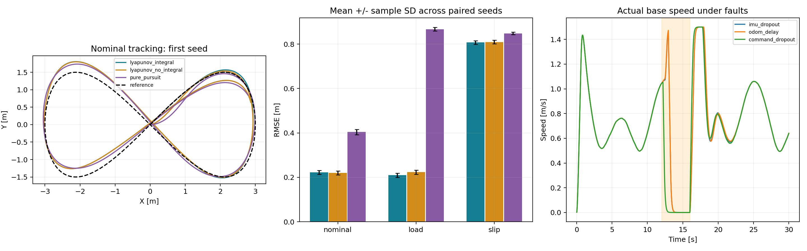

# Reproducible experiment results

120 trials; seeds: [11, 23, 42, 71, 101]; duration 30 s per trial.

Fault window: [12,16) seconds. All controllers share noise seeds, plant, initial pose and output limits.
Pure Pursuit uses a fixed 0.6 s preview; gains were not optimized per scenario.

| Scenario | Controller | Mean RMSE [m] | Sample SD [m] |
|---|---|---:|---:|
| nominal | lyapunov_integral | 0.2226 | 0.0090 |
| nominal | lyapunov_no_integral | 0.2202 | 0.0089 |
| nominal | pure_pursuit | 0.4043 | 0.0118 |
| load | lyapunov_integral | 0.2094 | 0.0093 |
| load | lyapunov_no_integral | 0.2232 | 0.0093 |
| load | pure_pursuit | 0.8670 | 0.0078 |
| slip | lyapunov_integral | 0.8070 | 0.0083 |
| slip | lyapunov_no_integral | 0.8094 | 0.0082 |
| slip | pure_pursuit | 0.8481 | 0.0059 |
| imu_dropout | lyapunov_integral | 0.8561 | 0.0045 |
| imu_dropout | lyapunov_no_integral | 0.8681 | 0.0046 |
| imu_dropout | pure_pursuit | 1.4318 | 0.0045 |
| odom_dropout | lyapunov_integral | 0.9255 | 0.0055 |
| odom_dropout | lyapunov_no_integral | 0.9371 | 0.0052 |
| odom_dropout | pure_pursuit | 1.4627 | 0.0045 |
| odom_delay | lyapunov_integral | 0.9255 | 0.0055 |
| odom_delay | lyapunov_no_integral | 0.9371 | 0.0052 |
| odom_delay | pure_pursuit | 1.4627 | 0.0045 |
| nonfinite | lyapunov_integral | 0.9255 | 0.0055 |
| nonfinite | lyapunov_no_integral | 0.9371 | 0.0052 |
| nonfinite | pure_pursuit | 1.4627 | 0.0045 |
| command_dropout | lyapunov_integral | 0.8419 | 0.0056 |
| command_dropout | lyapunov_no_integral | 0.8514 | 0.0054 |
| command_dropout | pure_pursuit | 1.4835 | 0.0046 |

Fault scenarios intentionally interrupt tracking; RMSE measures the resulting degradation, not only tracking quality.
Slip affects ground speed but not encoders; absolute localization drift is expected.
The headless simulator models wheel dynamics, not contact physics, obstacles or Gazebo.
Raw per-trial metrics: trials.csv. Selected first-seed traces: representative_traces.npz; column names: manifest.json.
