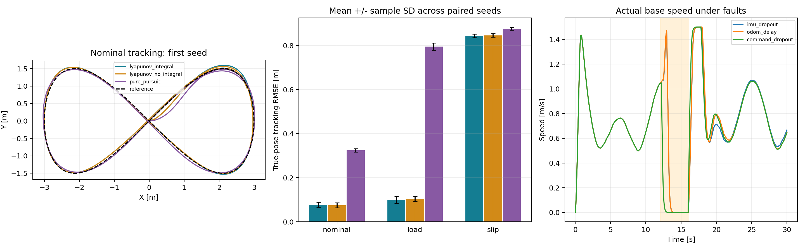

# Reproducible experiment results

120 trials; seeds: [11, 23, 42, 71, 101]; duration 30 s per trial.

Fault window: [12,16) seconds. All controllers share noise seeds, plant, initial pose and output limits.
Gyro bias remains injected at 0.005 rad/s; estimator starts with bias zero and learns against wheel yaw rate.
Absolute heading/position remain unobservable; differential slip can be absorbed into bias.
The historical tracking_rmse_m field is a true-pose metric; estimated tracking is reported separately.
Pure Pursuit uses a fixed 0.6 s preview; gains were not optimized per scenario.

| Scenario | Controller | True-pose mean RMSE [m] | True-pose sample SD [m] | Estimated-pose mean RMSE [m] |
|---|---|---:|---:|---:|
| nominal | lyapunov_integral | 0.0772 | 0.0111 | 0.0649 |
| nominal | lyapunov_no_integral | 0.0752 | 0.0112 | 0.0630 |
| nominal | pure_pursuit | 0.3243 | 0.0080 | 0.3328 |
| load | lyapunov_integral | 0.0996 | 0.0155 | 0.0944 |
| load | lyapunov_no_integral | 0.1040 | 0.0111 | 0.1039 |
| load | pure_pursuit | 0.7950 | 0.0161 | 0.8091 |
| slip | lyapunov_integral | 0.8437 | 0.0082 | 0.1091 |
| slip | lyapunov_no_integral | 0.8462 | 0.0080 | 0.1080 |
| slip | pure_pursuit | 0.8758 | 0.0061 | 0.3263 |
| imu_dropout | lyapunov_integral | 0.8366 | 0.0152 | 0.8619 |
| imu_dropout | lyapunov_no_integral | 0.8394 | 0.0144 | 0.8682 |
| imu_dropout | pure_pursuit | 1.3910 | 0.0107 | 1.4812 |
| odom_dropout | lyapunov_integral | 0.8959 | 0.0062 | 0.8948 |
| odom_dropout | lyapunov_no_integral | 0.9061 | 0.0056 | 0.9016 |
| odom_dropout | pure_pursuit | 1.4144 | 0.0100 | 1.4896 |
| odom_delay | lyapunov_integral | 0.8959 | 0.0062 | 0.8948 |
| odom_delay | lyapunov_no_integral | 0.9061 | 0.0056 | 0.9016 |
| odom_delay | pure_pursuit | 1.4144 | 0.0100 | 1.4896 |
| nonfinite | lyapunov_integral | 0.8959 | 0.0062 | 0.8948 |
| nonfinite | lyapunov_no_integral | 0.9061 | 0.0056 | 0.9016 |
| nonfinite | pure_pursuit | 1.4144 | 0.0100 | 1.4896 |
| command_dropout | lyapunov_integral | 0.8605 | 0.0087 | 0.8678 |
| command_dropout | lyapunov_no_integral | 0.8674 | 0.0081 | 0.8746 |
| command_dropout | pure_pursuit | 1.4775 | 0.0049 | 1.4886 |

Fault scenarios intentionally interrupt tracking; RMSE measures the resulting degradation, not only tracking quality.
Slip affects ground speed but not encoders; absolute localization drift is expected.
The headless simulator models wheel dynamics, not contact physics, obstacles or Gazebo.
Raw per-trial metrics: trials.csv. Selected first-seed traces: representative_traces.npz; column names: manifest.json.
