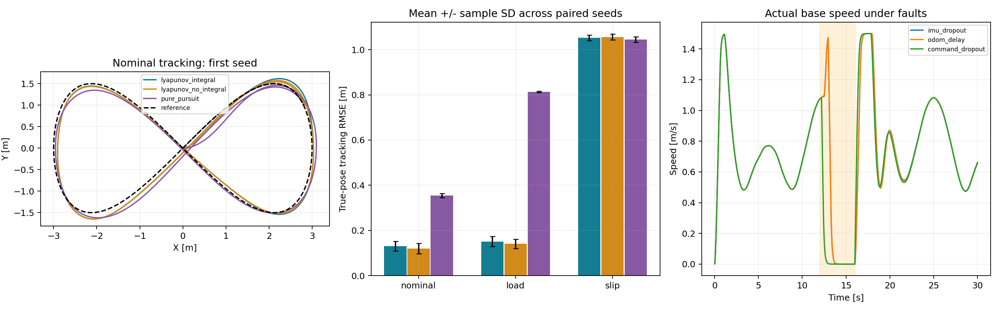

# Reproducible experiment results

120 trials; seeds: [11, 23, 42, 71, 101]; duration 30 s per trial.

Fault window: [12,16) seconds. All controllers share noise seeds, plant, initial pose and output limits.
Gyro bias remains injected at 0.005 rad/s; estimator starts with bias zero and learns against wheel yaw rate.
Absolute heading/position remain unobservable; differential slip can be absorbed into bias.
The historical tracking_rmse_m field is a true-pose metric; estimated tracking is reported separately.
Pure Pursuit uses a fixed 0.6 s preview; gains were not optimized per scenario.

| Scenario | Controller | True-pose mean RMSE [m] | True-pose sample SD [m] | Estimated-pose mean RMSE [m] |
|---|---|---:|---:|---:|
| nominal | lyapunov_integral | 0.1307 | 0.0212 | 0.0889 |
| nominal | lyapunov_no_integral | 0.1195 | 0.0228 | 0.0834 |
| nominal | pure_pursuit | 0.3547 | 0.0093 | 0.3923 |
| load | lyapunov_integral | 0.1508 | 0.0223 | 0.1088 |
| load | lyapunov_no_integral | 0.1406 | 0.0211 | 0.1141 |
| load | pure_pursuit | 0.8127 | 0.0030 | 0.8474 |
| slip | lyapunov_integral | 1.0527 | 0.0128 | 0.0945 |
| slip | lyapunov_no_integral | 1.0559 | 0.0128 | 0.0891 |
| slip | pure_pursuit | 1.0452 | 0.0123 | 0.4136 |
| imu_dropout | lyapunov_integral | 0.9164 | 0.0086 | 0.8673 |
| imu_dropout | lyapunov_no_integral | 0.9178 | 0.0081 | 0.8770 |
| imu_dropout | pure_pursuit | 1.3906 | 0.0009 | 1.5040 |
| odom_dropout | lyapunov_integral | 0.8104 | 0.0066 | 0.8701 |
| odom_dropout | lyapunov_no_integral | 0.8159 | 0.0062 | 0.8801 |
| odom_dropout | pure_pursuit | 1.3930 | 0.0015 | 1.5040 |
| odom_delay | lyapunov_integral | 0.8104 | 0.0066 | 0.8701 |
| odom_delay | lyapunov_no_integral | 0.8159 | 0.0062 | 0.8801 |
| odom_delay | pure_pursuit | 1.3930 | 0.0015 | 1.5040 |
| nonfinite | lyapunov_integral | 0.8104 | 0.0066 | 0.8701 |
| nonfinite | lyapunov_no_integral | 0.8159 | 0.0062 | 0.8801 |
| nonfinite | pure_pursuit | 1.3930 | 0.0015 | 1.5040 |
| command_dropout | lyapunov_integral | 0.8616 | 0.0089 | 0.8333 |
| command_dropout | lyapunov_no_integral | 0.8700 | 0.0084 | 0.8433 |
| command_dropout | pure_pursuit | 1.5132 | 0.0057 | 1.4987 |

Fault scenarios intentionally interrupt tracking; RMSE measures the resulting degradation, not only tracking quality.
Slip affects ground speed but not encoders; absolute localization drift is expected.
The headless simulator models wheel dynamics, not contact physics, obstacles or Gazebo.
Raw per-trial metrics: trials.csv. Selected first-seed traces: representative_traces.npz; column names: manifest.json.
