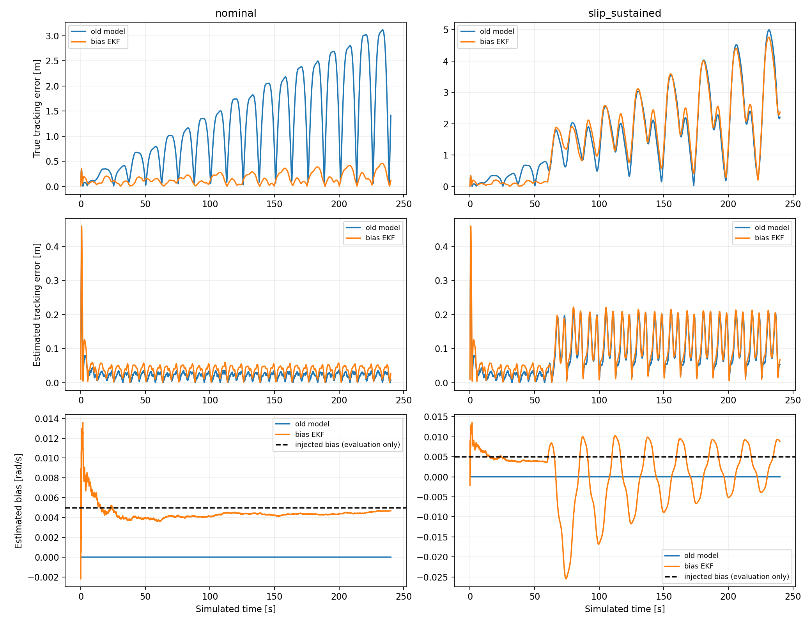

# Paired multi-minute gyro-bias validation

110 trials; 240 simulated seconds each; paired seeds [11, 23, 42, 71, 101].

Ground truth is evaluation-only. Default injected bias stays +0.005 rad/s; signed-bias stress cases use -0.02/+0.03 rad/s.
No per-scenario tuning. Original artifacts remain untouched. All failures and unfavorable pose errors are retained.

| Profile | Bias estimation | Last 30 s TRUE RMSE mean ± SD [m] | Last 30 s ESTIMATED RMSE mean ± SD [m] | Final bias mean [rad/s] |
|---|---|---:|---:|---:|
| nominal | False | 2.3168 ± 0.0277 | 0.0223 ± 0.0005 | 0.000000 |
| nominal | True | 0.1838 ± 0.0962 | 0.0387 ± 0.0006 | 0.004714 |
| load | False | 2.3165 ± 0.0277 | 0.0223 ± 0.0005 | 0.000000 |
| load | True | 0.1881 ± 0.0929 | 0.0387 ± 0.0006 | 0.004714 |
| slip_transient | False | 2.5417 ± 0.0254 | 0.0223 ± 0.0005 | 0.000000 |
| slip_transient | True | 2.7517 ± 0.1272 | 0.0387 ± 0.0006 | 0.003042 |
| slip_sustained | False | 3.0323 ± 0.0351 | 0.1272 ± 0.0002 | 0.000000 |
| slip_sustained | True | 2.8607 ± 0.0894 | 0.1312 ± 0.0002 | 0.008791 |
| imu_dropout | False | 4.0641 ± 0.0436 | 0.0223 ± 0.0005 | 0.000000 |
| imu_dropout | True | 2.2901 ± 0.1110 | 0.0387 ± 0.0006 | 0.003609 |
| odom_dropout | False | 3.9731 ± 0.0488 | 0.0223 ± 0.0005 | 0.000000 |
| odom_dropout | True | 2.3296 ± 0.0964 | 0.0387 ± 0.0006 | 0.004745 |
| odom_delay | False | 3.9731 ± 0.0488 | 0.0223 ± 0.0005 | 0.000000 |
| odom_delay | True | 2.3296 ± 0.0964 | 0.0387 ± 0.0006 | 0.004745 |
| nonfinite | False | 3.9731 ± 0.0488 | 0.0223 ± 0.0005 | 0.000000 |
| nonfinite | True | 2.3296 ± 0.0964 | 0.0387 ± 0.0006 | 0.004745 |
| command_dropout | False | 2.3192 ± 0.0295 | 0.0223 ± 0.0005 | 0.000000 |
| command_dropout | True | 0.2339 ± 0.0890 | 0.0387 ± 0.0006 | 0.004714 |
| negative_bias | False | 3.7823 ± 0.0211 | 0.0242 ± 0.0004 | 0.000000 |
| negative_bias | True | 0.1878 ± 0.1004 | 0.0387 ± 0.0006 | -0.020277 |
| positive_bias | False | 0.7122 ± 0.0183 | 0.0260 ± 0.0004 | 0.000000 |
| positive_bias | True | 0.1887 ± 0.0947 | 0.0387 ± 0.0006 | 0.029704 |

Numerical finite/command/fault-stop/recovery checks: 110/110 trials passed.
This check count is not a declaration of acceptable tracking in slip/fault cases. See true-pose errors above.
Wheel slip and wheel scale/yaw bias are not independently separable from gyro bias with these sensors.
No absolute pose correction is provided. Estimated tracking error can remain small while true-pose tracking is poor.

